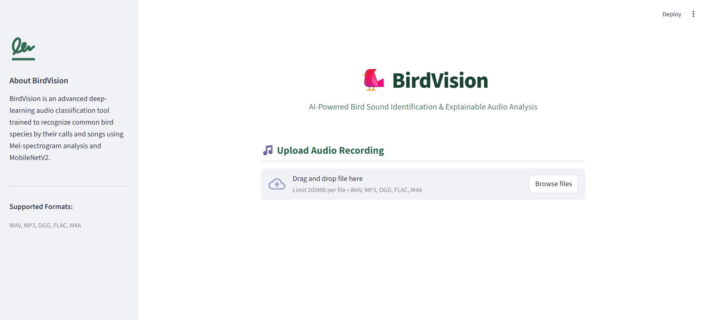
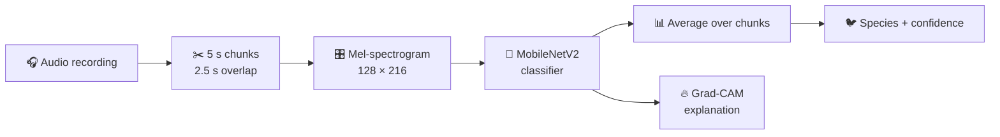

<div align="center">

# 🐦 BirdVision

### AI-Based Bird Sound Identification System

*Upload a bird call. Get the species, the confidence, and a visual explanation of why the model decided so.*


<br>



</div>

---

## ✨ Highlights

- 🎧 **Identifies 20 bird species** from audio recordings (WAV, MP3, OGG, FLAC, M4A)
- 🧩 **Chunk-based analysis:** long recordings are split into overlapping 5-second windows and the predictions are averaged
- 📊 **Top-5 probabilities** with a confidence score for every prediction
- 🔥 **Explainable AI:** Grad-CAM shows which time-frequency regions of the spectrogram drove the decision
- 🌐 **Web app** built with Streamlit, ready to run locally

---

## 🧠 How it works



Each chunk is converted into a mel-spectrogram, a picture of how the sound's frequencies change over time. MobileNetV2 (pretrained on ImageNet) is fine-tuned to classify these pictures, and Grad-CAM highlights the parts of the picture it relied on.

---

## 🐤 Species covered

| Group | Species |
|---|---|
| **Waders and shorebirds** | Black-winged Stilt, Common Greenshank, Common Sandpiper, Green Sandpiper, Little Ringed Plover, Wood Sandpiper |
| **Herons and egrets** | Black-crowned Night-Heron, Gray Heron, Little Egret |
| **Waterbirds** | Eurasian Coot, Eurasian Moorhen, Little Grebe |
| **Songbirds** | Barn Swallow, Blyth's Reed Warbler, Common Rosefinch, Greenish Warbler, Western Yellow Wagtail, Zitting Cisticola |
| **Others** | Common Kingfisher, Rose-ringed Parakeet |

The class order used by the model is stored in [`models/class_names.json`](models/class_names.json).

---

## 🚀 Quick start

```bash
# 1. Clone the repository
git clone https://github.com/madhur1702/BirdVision-AI_Based_Bird_Sound_Identification_System.git
cd BirdVision-AI_Based_Bird_Sound_Identification_System

# 2. Create a virtual environment (recommended)
python -m venv .venv
# Windows: .venv\Scripts\activate
# Linux/macOS: source .venv/bin/activate

# 3. Install dependencies
pip install -r requirements.txt

# 4. Launch the app
streamlit run app/app.py
```

Then open the local URL shown in the terminal, upload a bird recording and click **Analyze Audio**.

---

## 🛠️ Tech stack

| Area | Tools |
|---|---|
| Deep learning | TensorFlow / Keras, MobileNetV2 (transfer learning) |
| Audio processing | Librosa, NumPy |
| Explainability | Grad-CAM |
| Data handling | Pandas, scikit-learn |
| Web app | Streamlit, Matplotlib |

---

## 🔬 Model details

| | |
|---|---|
| **Backbone** | MobileNetV2 with ImageNet weights (grayscale mel input repeated to 3 channels) |
| **Input** | `128 × 216 × 1` mel-spectrogram in dB, range `[-80, 0]` (rescaled to `[-1, 1]` inside the model) |
| **Head** | Global average pooling, dropout 0.30, dense softmax over 20 classes |
| **Training** | Stage 1: frozen backbone (lr 1e-3). Stage 2: last 30 layers fine-tuned, BatchNorm frozen (lr 1e-5) |
| **Sampling** | Recording-balanced sampling, with 2x weight on five harder classes (Eurasian Moorhen, Eurasian Coot, Green Sandpiper, Little Grebe, Black-crowned Night-Heron) |
| **Augmentation** | Frequency masking, time masking, small time shift, Gaussian noise |
| **Split** | Per recording before chunking, so chunks of one recording never appear in two splits |

---

## 📂 Project structure

<details>
<summary><b>Click to expand</b></summary>

```
.
├── app/
│   └── app.py                   # Streamlit app with Grad-CAM
├── assets/
│   └── app_ui.png               # app screenshot
├── scripts/
│   ├── 01_dataset/              # species selection, quality filtering, split
│   ├── 02_preprocessing/        # chunking and mel-spectrogram generation
│   ├── 03_training/             # MobileNetV2 training
│   └── 04_evaluation/           # model evaluation
├── models/
│   ├── bird_mobilenetv2_exp5_final.keras
│   └── class_names.json
├── data/
│   └── README.md                # dataset source and rebuild guide
├── requirements.txt
└── README.md
```

</details>

---

## ♻️ Reproduce the pipeline

<details>
<summary><b>Click to expand</b></summary>

The audio and spectrograms are not stored in this repository. See [`data/README.md`](data/README.md) for the dataset source and settings. By default the scripts look for mels in `data/bird_mels/`; set the `BIRD_MEL_DIR` environment variable to use another folder.

```bash
# 1. Dataset and recording-level split
python scripts/01_dataset/create_dataset.py
python scripts/01_dataset/quality_summary.py
python scripts/01_dataset/quality_split.py
python scripts/01_dataset/review_details.py
python scripts/01_dataset/rebuild_split.py

# 2. Chunking and mel-spectrograms
python scripts/02_preprocessing/chunk_audio.py
python scripts/02_preprocessing/generate_mels.py
python scripts/02_preprocessing/verify_mels.py

# 3. Training
python scripts/03_training/train_mobilenetv2.py

# 4. Evaluation
python scripts/04_evaluation/evaluate_model.py
```

</details>

---

## 📚 Dataset

Recordings come from [BirdCLEF 2024](https://www.kaggle.com/competitions/birdclef-2024) (originally from Xeno-canto): 24,459 recordings across 182 species, of which 20 species are used here. Details and license notes are in [`data/README.md`](data/README.md).

---

<div align="center">

Built by [Madhur Bhandarkar](https://github.com/madhur1702)

</div>
